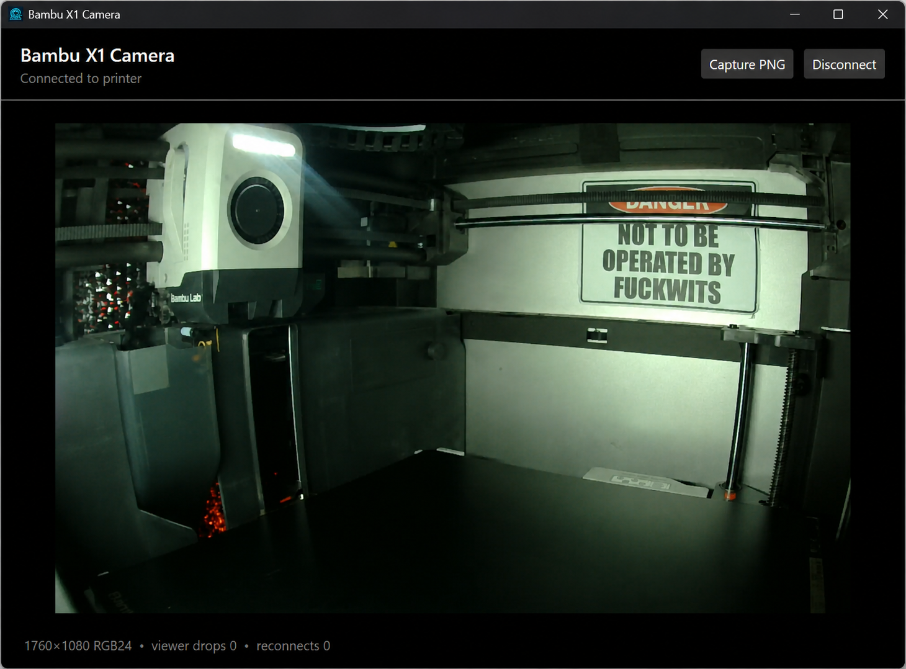

# BambuLab.X1Camera

Managed .NET 10 packages for integrating the Bambu Lab X1-series LAN camera into other applications. The primary deliverables are the packable `BambuLab.X1Camera` transport library and optional `BambuLab.X1Camera.Imaging` library. The transport connects directly to the printer's authenticated RTSPS endpoint and emits H.264 NAL units or complete access units with Annex-B framing; the imaging package decodes frames and still images in managed code.

The core library does not use `bambu_networking.dll`, DirectShow, Media Foundation, FFmpeg, GStreamer, VLC, P/Invoke, Python, or Node.js. It remains decoder-free. `BambuLab.X1Camera.Imaging` adds pure-managed H.264 and PNG decoding through Wixely/H264Sharp.

The Avalonia desktop viewer and console probe are sample applications that demonstrate how a host can consume these packages. They are not the primary product and Avalonia is not required by applications using either NuGet package. See the [project plan](docs/PROJECT-PLAN.md) for the architecture, milestones, acceptance criteria, and unresolved release choices.

The project is licensed under the [MIT License](LICENSE). Independently authored project code remains MIT-licensed; third-party code and dependencies may use MIT or BSD-3-Clause. The Avalonia sample's ANGLE renderer closure is the only separately recorded dependency-policy exception. See the [dependency and source policy](docs/DEPENDENCY-POLICY.md).

## Project layout and dependency boundary

| Project | Role | UI and decoder dependencies |
| --- | --- | --- |
| `BambuLab.X1Camera` | Packable camera transport and encoded H.264 API | No third-party package dependencies; no decoder; no Avalonia |
| `BambuLab.X1Camera.Imaging` | Packable optional RGB24 and PNG decoding | `H264Sharp.Decoder` only; no Avalonia |
| `BambuLab.X1Camera.Probe` | Non-packable console sample and hardware diagnostic | References the two library projects; no UI framework |
| `BambuLab.X1Camera.Desktop` | Non-packable Windows/Linux sample application | References both library projects and uses Avalonia for sample UI/rendering |

Avalonia is used only by the desktop sample application. It is not referenced by either NuGet library project and does not become a dependency of `BambuLab.X1Camera` or `BambuLab.X1Camera.Imaging`.

## Current status

- Implements RTSPS over `SslStream` on the X1 default port, RTSP Basic and Digest authentication, SDP track discovery, interleaved RTP, H.264 single-NAL, STAP-A, FU-A, and complete access-unit assembly.
- Uses one RTSP reader to dispatch control responses by `CSeq` while feeding a bounded RTP queue. It acknowledges adaptive `OPTIONS` keepalives and teardown, exposes stream-health metrics, and reconnects established streams with a bounded retry policy.
- Supports OS certificate validation or a configured SHA-256 certificate pin. The console probe can perform an explicit trust-on-first-use certificate observation without sending credentials, then pin the accepted certificate for the authenticated connection.
- Includes bounded protocol specifications, an interactive console probe, and an Avalonia desktop client with secure first-contact certificate pinning, optional encoded settings, live RGB24 video, and PNG capture.
- A 35-second Windows hardware run against a physical X1C validated TLS pinning, legacy Digest authentication, SDP, setup/playback, six adaptive keepalive acknowledgements, acknowledged teardown, and 901 encoded H.264 NAL units with no observed packet gaps, malformed packets, queue drops, or reconnects. Longer-duration and interruption/restart validation remain before the implementation is treated as stable.
- A subsequent 10-second hardware run validated the access-unit API with 239 complete encoded frames, repeated SPS/PPS-equipped IDR output, normalized presentation times, acknowledged keepalive and teardown, and no observed packet gaps, malformed packets, queue drops, or reconnects.
- A hardware still-capture run decoded the next IDR through H264Sharp into a structurally and visually validated 1760x1080 PNG, without retaining the private image in the repository.
- A physical Windows desktop run connected, navigated to the viewer, batch-decoded a bounded GOP through H264Sharp, and displayed an RGB24 frame. The temporary ignored settings copy used for that test was deleted afterward.
- Self-contained single-file Windows and Linux desktop artifacts both passed graphical startup tests. A separate Linux physical-device run streamed for eight seconds and captured a valid PNG through H264Sharp. Longer-duration Linux desktop video validation remains planned.
- A repository-owned GitHub Actions workflow verifies Windows and Linux on every change. Tags matching the package version build, validate in a clean consumer, and publish both NuGet packages to GitHub Packages; the host plugin contract remains planned.

## Install the packages

The latest prerelease is `0.1.0-alpha.3`. Both packages are published from approved `v*` tags to Wixely's GitHub Packages NuGet feed:

```powershell
dotnet nuget add source "https://nuget.pkg.github.com/Wixely/index.json" `
    --name github-wixely `
    --username Wixely `
    --password $env:GITHUB_PACKAGES_TOKEN `
    --store-password-in-clear-text

dotnet add package BambuLab.X1Camera --version 0.1.0-alpha.3
dotnet add package BambuLab.X1Camera.Imaging --version 0.1.0-alpha.3
```

GitHub requires authentication for NuGet package downloads, including public packages. Use a classic personal access token with `read:packages`, keep it outside the repository, and clear the environment variable after configuring the user-level NuGet credentials. Applications that only need encoded H.264 should install the core package; install the imaging package when RGB24 or PNG decoding is required. Neither package depends on Avalonia.

## Build and verify

Requirements: .NET SDK 10.0.300 or a later 10.0 patch.

`BambuLab.X1Camera.Imaging` depends on the pure-managed, MIT-licensed `H264Sharp.Decoder` 1.0.2 package from Wixely's GitHub Packages feed. It has no transitive package or native dependencies. GitHub currently requires authentication even for public packages. Configure that feed with a token carrying `read:packages` before a clean restore; do not commit the token. The repository's `NuGet.config` contains only the public feed URL.

```powershell
dotnet build .\BambuX1Camera.slnx
dotnet run --project .\tests\BambuLab.X1Camera.Specs\BambuLab.X1Camera.Specs.csproj
```

The repository includes VS Code build and debug configuration. The default debug target runs the protocol specifications and never requests printer credentials.

## Sample desktop application



The non-packable Avalonia sample displaying a live stream. It demonstrates connection, decoding, display, and PNG capture using the reusable packages; applications can provide any user interface or consume the encoded H.264 without a UI. The private printer address and equipment label have been redacted from this screenshot.

Approved version tags publish the sample through [GitHub Releases](https://github.com/Wixely/BambuX1Camera/releases) as direct, self-contained single-file downloads for Windows x64 and Linux x64. Windows users can run the `.exe` directly. On Linux, mark the extensionless download executable with `chmod +x` and launch it from an X11 or XWayland desktop. No separately installed .NET runtime is required. Each release also includes SHA-256 checksums and a separate archive containing the project license and required native-renderer notices.

Start the Avalonia desktop client on Windows or Linux:

```powershell
dotnet run --project .\samples\BambuLab.X1Camera.Desktop\BambuLab.X1Camera.Desktop.csproj
```

Enter the printer address and LAN access code. Before sending credentials, the application observes the printer TLS certificate and requires an explicit trust decision if the operating system does not trust it. A successful connection opens a separate viewer page that batch-decodes bounded H.264 GOPs off the UI thread. The capture button decodes the next complete keyframe and opens the platform PNG save picker. The project-owned camera/layer icon is embedded into both the Windows executable and the Avalonia window.

Saving is optional. When enabled, the application writes the compatible `bambu-x1-camera.settings.json` file beside its executable. Values are Base64-encoded UTF-8 rather than encrypted; this prevents accidental plaintext disclosure but does not protect against a user or process that can read the file.

Create self-contained single-file builds for 64-bit Windows and Linux:

```powershell
.\scripts\Publish-Desktop.ps1
```

Outputs are written beneath `artifacts/desktop/win-x64` and `artifacts/desktop/linux-x64`. Each platform directory contains its single-file executable, XML API documentation, project-level notices, and the exact native renderer notices under `licenses/`. The application does not require a separately installed .NET runtime. Native renderer libraries are extracted to the platform temporary directory when the single-file application starts.

Linux requires a graphical desktop with X11 or XWayland and Avalonia's documented system packages. On Debian or Ubuntu:

```bash
sudo apt install libx11-6 libice6 libsm6 libfontconfig1
```

## Probe a printer

Enable LAN live view on the printer, build the solution, and start the probe interactively:

```powershell
.\samples\BambuLab.X1Camera.Probe\bin\Debug\net10.0\BambuLab.X1Camera.Probe.exe --configure --duration 30
```

The probe masks access-code input. When no certificate pin is available, it observes the certificate without sending credentials and asks before trusting and pinning it. It then offers to save the printer address, access code, and certificate pin in `bambu-x1-camera.settings.json` beside the executable. Values are Base64-encoded UTF-8: this is reversible encoding, not encryption. Saving is opt-in and the filename is ignored by Git.

Later runs load that file automatically. Use `--configure` to replace it, `--duration N` for a bounded test, `--output capture.h264` to save the encoded Annex-B stream, or `--png still.png` to decode the next keyframe. Capture output uses `FileMode.CreateNew` so it cannot silently overwrite an existing file.

Environment variables remain available for automation and take precedence over the saved file:

```powershell
$env:BAMBU_X1_HOST = "printer-address"
$env:BAMBU_X1_ACCESS_CODE = "access-code"
$env:BAMBU_X1_CERT_SHA256 = "printer-certificate-sha256-fingerprint"
dotnet run --project .\samples\BambuLab.X1Camera.Probe\BambuLab.X1Camera.Probe.csproj -- --duration 30
```

Environment variables are inherited by child processes. Clear sensitive values from the shell after testing:

```powershell
Remove-Item Env:BAMBU_X1_ACCESS_CODE
```

## API shape

```csharp
var options = new X1CameraOptions(host, accessCode)
{
    PinnedCertificateSha256 = certificateFingerprint,
    ReconnectAttempts = 3,
    FrameQueueCapacity = 256
};

await using var session = await new X1CameraClient().ConnectAsync(options, cancellationToken);
await foreach (var nalUnit in session.ReadNalUnitsAsync(cancellationToken))
{
    // nalUnit.AnnexBData remains encoded H.264.
}

// Alternatively, consume complete encoded frames for a decoder or restreamer.
await foreach (var accessUnit in session.ReadAccessUnitsAsync(cancellationToken))
{
    // accessUnit.AnnexBData includes cached SPS/PPS before IDR frames when needed.
}

var metrics = session.Metrics;
```

Decode a complete IDR-led GOP into display-order RGB24 frames in a desktop host:

```csharp
var frames = new X1CameraGopDecoder().Decode(accessUnits);
foreach (var frame in frames)
{
    // frame.Rgb24Data is tightly packed width * height * 3 RGB data.
}
```

Install the optional imaging package and capture a still from a fresh session:

```csharp
using BambuLab.X1Camera.Imaging;

await using var session = await new X1CameraClient().ConnectAsync(options, cancellationToken);
var image = await session.CapturePngAsync(cancellationToken);
await File.WriteAllBytesAsync("still.png", image.Data, cancellationToken);
```

`CapturePngAsync` owns the session's single reader until it returns. Applications that need simultaneous still capture and live forwarding should read `ReadAccessUnitsAsync` once, fan out through bounded application queues, and pass a keyframe to `X1CameraPngDecoder.Decode`.

The built-in fan-out hub provides that single-reader pattern:

```csharp
await using var hub = new X1CameraAccessUnitHub(session);
await using var video = hub.Subscribe(capacity: 8);
await using var still = hub.Subscribe(capacity: 2);

var image = await still.CapturePngAsync(cancellationToken);
await foreach (var accessUnit in video.ReadAllAsync(cancellationToken))
{
    // Forward or decode accessUnit.AnnexBData.
}
```

Each subscriber has an independent bounded queue and `DroppedAccessUnits` counter. A slow consumer drops its oldest queued frames without delaying the printer reader or other consumers.

Only one reader is permitted per printer session, using either the NAL or access-unit API. Access units are bounded, carry normalized presentation time across normal 32-bit RTP wraparound, and flag discontinuities so a decoder or restreamer can reset and wait for a keyframe. `Metrics` is a thread-safe snapshot containing packet gaps, malformed or unexpected packets, bounded-queue drops, NAL output, reconnects, and acknowledged lifecycle requests. A plugin host should maintain one connection and use `X1CameraAccessUnitHub` for bounded consumers.

## Security

- Never log the access code, authorization headers, printer serial, certificate fingerprint, or private network address.
- Prefer a verified SHA-256 certificate pin when the printer certificate is not trusted by the operating system. Do not ship with `AllowUntrustedCertificate` enabled.
- The probe's optional local JSON is intended only for isolated development. Base64 does not protect credentials from another user or process that can read the file; delete it after testing or use environment variables instead on shared systems.
- Bind any future restream endpoint to an explicitly configured interface, authenticate viewers, and default recording to off.
- The protocol is not an officially supported Bambu third-party contract and may change with firmware.

## Project boundaries

The source repository and associated packages are published publicly under `Wixely/BambuX1Camera`. Version tags remain prereleases until the outstanding hardware/recovery matrix and public API stability work in the project plan are complete.

H264Sharp 1.0.2 is MIT-licensed. Its third-party notice preserves a precautionary BSD-2-Clause attribution for CABAC context-initialization values transcribed through OpenH264, while also stating that H.264 specification formulas and lookup tables are not subject to third-party copyright. The [current H264Sharp README](https://github.com/Wixely/H264Sharp#licensing) further clarifies that these values are mandated by ITU-T H.264 Tables 9-12 through 9-24 and that the precautionary attribution does not change the project's MIT licensing. This repository retains the attribution in [third-party notices](THIRD-PARTY-NOTICES.md).

Avalonia 12.1.1 is MIT-licensed and is used only by the non-packable desktop sample. Its native Skia renderer is admitted under the repository's BSD-3-Clause policy. ANGLE and its bundled third-party closure retain the narrow exception approved on 2026-08-24 and recorded in the same policy and notices files. Those renderer dependencies are distributed with the portable sample builds, not with either NuGet library package.
